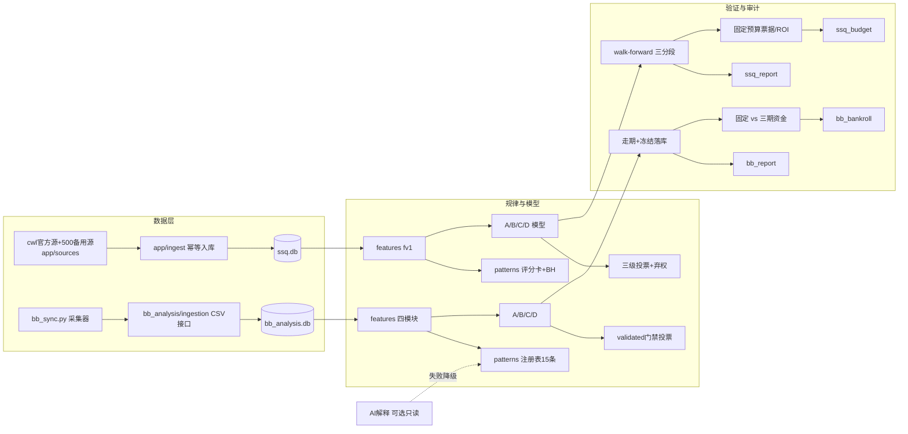

# LottoLab — 彩票历史数据分析与研究平台

> **定位**：可安装、可测试、可复现、可审计的开源研究平台。
> **不是**预测保证：截至 V1.1，两侧回测统一结论为 **“未发现可靠优势”**——
> 无模型通过预定义的统计门槛，任何历史差异都不构成未来中奖概率的提升。

两套**相互独立**的数据系统（代码、库、配置、测试完全隔离）：

| 系统 | 代码 | 数据 | 入口 |
| --- | --- | --- | --- |
| 双色球 SSQ | `app/` | `data/ssq.db`（2003001–2026116，3513期） | `python -m app …` |
| BB六合彩 | `bb_analysis/` + `bb_sync.py` | `data/bb_live_history.csv`（251期）+ `data/bb_analysis.db` | `python -m bb_analysis …` |

## 架构



## 快速开始

```bash
git clone https://github.com/QS1314520ZHOU/LottoLab.git
cd LottoLab
python -m venv .venv && .venv\Scripts\activate   # Windows；POSIX: source .venv/bin/activate
pip install -r requirements.txt
cp .env.example .env        # 可选；无密钥也能跑，AI 功能需自备 MIMO_AI_KEY
```

### 双色球

```bash
python -m app discover-sources   # 探测数据源（官网+备用）
python -m app import-history     # 全量导入（幂等）
python -m app update             # 增量更新
python -m app validate-data      # 数据质量
python -m app analyze            # 特征+规律评分卡（BH校正）
python -m app backtest           # 严格走期回测（三分段）
python -m app tickets --budget 20  # 固定预算 ROI 对照（同预算同周期）
python -m app report             # 报告（含来源分标与结论句）
```

### BB六合彩

```bash
python -m bb_analysis import     # 导入采集 CSV（幂等，不动原文件）
python -m bb_analysis patterns   # 规律注册表15条 → bb_pattern_registry.json
python -m bb_analysis backtest   # 走期回测+预测冻结落库
python -m bb_analysis bankroll   # 固定 vs 三期资金策略
python -m bb_analysis report     # 汇总报告
python -m bb_analysis ui         # Streamlit 面板（模型/风险/数据时间/证据等级）
```

### 测试与质量门

```bash
python -m pytest tests/ -q                       # 61 项（见 docs/V1_1_TEST_REPORT.md）
python -m compileall app bb_analysis tests
ruff check --select E9,F63,F7,F82,F821 app bb_analysis tests
```

## 研究结论（V1.1，实测）

- BB：15 条规律 `validated=0`（BH q + holdout 双门槛）；模型评级全部 `unproven`；
  holdout 四模型 `q≥0.05`；**未发现可靠优势**。
- 双色球：7 条规律全部 `exploratory`；holdout 无模型 Brier 优于公平基线；
  蓝球 Markov 独立性 p=0.588；**未发现可靠优势**。
- 资金策略：三期加倍与固定注额**命中序列完全相同**，只放大波动与资金需求。

## 文档索引

| 文档 | 内容 |
| --- | --- |
| `docs/V1_1_AUDIT.md` | 功能真实状态（已验证/未验证/未实现/风险） |
| `docs/V1_1_TEST_REPORT.md` | 本轮真实测试命令与结果 |
| `docs/RELEASE_CHECKLIST.md` | 发布检查清单 |
| `docs/BB_PLATFORM.md` | BB 架构/映射/赔率证据/回测方法 |
| `docs/DATA_SOURCES.md` | 双色球数据源实测与限制 |
| `docs/ARCHITECTURE.md` `docs/BACKTEST_METHODOLOGY.md` | SSQ 架构与方法学 |
| `docs/IOI_LOTTOLAB_REVIEW.md` | 参考仓库审查（REUSE/ADAPT/REJECT） |
| `docs/LEGACY_SCRIPTS.md` | 旧版脚本用途与处置 |
| `docs/MIGRATION_NOTES.md` | 数据库与迁移 |

## 依赖与许可

- Python 3.11+（CI 矩阵 3.11/3.12；本地实测 3.12.7，干净环境实测 numpy 2.5.4 兼容）
- 核心：numpy / pandas / scipy / scikit-learn / requests / pytest；可选：streamlit、matplotlib
- 本项目 **MIT License**（见 `LICENSE`）；架构参考
  [IOI-LottoLab](https://github.com/ioi-studio/IOI-LottoLab)（MIT，零代码复制，见审查文档）

## 免责声明

历史回测、规律评分与任何报告都不代表未来收益，不构成投注建议；
彩票开奖为独立随机事件，请遵守当地法律法规，理性对待。
